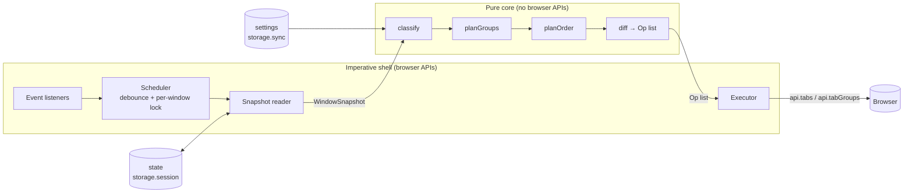
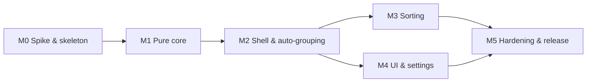

# Auto Sort Tabs — Implementation Plan

A lean, cross-browser (Chromium + Firefox) extension that automatically groups
tabs into native tab groups and keeps them sorted.

## 1. Goals and non-goals

**Goals**

- Auto-group tabs by domain, with optional user rules (pattern → group name/colour).
- Sort tabs inside groups, and sort groups relative to each other.
- Never destroy user intent: pinned tabs, user-created groups and manual moves are respected.
- One TypeScript codebase, no runtime dependencies, no bundler (only `tsc` emit).

**Non-goals** (explicitly out of scope)

Session save/restore, sidebar/tree UI, cloud sync beyond `storage.sync`, tab
discarding/auto-close, analytics, content scripts, host permissions.

## 2. Platform baseline

| | Chromium | Firefox |
|---|---|---|
| Min version | 121 (MV3 + `tabGroups` since 89; `lastAccessed` on tabs since 121) | 139 (`tabs.group` in 138, `tabGroups` API in 139) |
| Background | `background.service_worker` | `background.scripts` (non-persistent event page) |
| API namespace | `chrome.*` (promise-based in MV3) | `browser.*` (promise-based) |

- Permissions: `tabs`, `tabGroups`, `storage`. No host permissions.
- Namespace shim: `const api = globalThis.browser ?? globalThis.chrome;` — no
  `webextension-polyfill` needed, since both expose promises for the APIs we use.
- **Single manifest** declaring both `service_worker` and `scripts` in
  `background` (each browser picks the key it supports) plus
  `browser_specific_settings.gecko.id`. ⚠️ To be confirmed in the M0 spike; fallback
  is a tiny script that emits two manifests.

### 2.1 Toolchain

All dev-only; nothing ships except emitted JS, HTML, CSS and the manifest.

| Tool | Purpose |
|---|---|
| **TypeScript 7** (`typescript@^7`, native `tsc`) | Type checking for readability and safety, plus emit to `dist/` |
| **Prettier** | Formatting; `format:check` runs in CI |
| **Node `--test`** | Test runner; runs `.ts` directly via Node's built-in type stripping (no compile step for tests) |
| `@types/chrome` | API typings (Firefox exposes the same shape for the APIs we use) |
| `web-ext` | Firefox run/lint and packaging |

`tsconfig` essentials:

- `strict` (default in TS 7), `target`/`module: esnext`, `noUncheckedIndexedAccess`.
- `erasableSyntaxOnly: true`: no enums or namespaces, so Node can strip types and run tests directly.
- `allowImportingTsExtensions` + `rewriteRelativeImportExtensions`: source imports use
  `./x.ts`, and emitted JS imports `./x.js`, which browsers can load as native ES modules.
- Build = `tsc` + copy `manifest.json`, `*.html`, `*.css`, icons into `dist/`. No bundler.
- TS 7 has no stable compiler API yet, so avoid tooling that hooks into it (e.g.
  `typescript-eslint`). Prettier and `web-ext` are unaffected.

## 3. Architecture

### 3.1 Pattern: functional core, imperative shell + reconcile loop

The extension is a **reconciler** (same idea as React or Kubernetes controllers):

```
observe → snapshot → compute desired state → diff → apply minimal ops
```

- **Idempotent**: running the pipeline on an already-organized window produces zero ops.
  This is what makes the system robust to event storms, service-worker termination
  mid-run and our own moves re-triggering events — any run simply converges.
- **Pure core**: everything that decides *what* should happen is a pure function over
  plain data (no browser APIs). Unit-testable in Node in milliseconds.
- **Thin shell**: only the shell touches `api.*` (read snapshot, apply ops, listen to events).



### 3.2 Building blocks vs interconnected system

**Composable building blocks**, connected by a single linear pipeline and plain
data contracts. Not a plugin system (YAGNI), but every decision point is a small
swappable function:

| Block | Signature (conceptual) | Swappable via |
|---|---|---|
| `classify` | `(tab, settings) → GroupKey \| null` | key strategy: `hostname`, `domain`, rule match |
| `planGroups` | `(snapshot, keys, settings) → DesiredGroups` | min-tabs threshold, ownership policy |
| `planOrder` | `(desiredGroups, settings) → DesiredLayout` | comparator map (`title`, `url`, `domain`, `lastAccessed`) |
| `diff` | `(snapshot, desiredLayout) → Op[]` | — (single algorithm, see §4.3) |
| `execute` | `(Op[]) → Promise<Result>` | — |

Blocks only share data types (`TabInfo`, `GroupInfo`, `WindowSnapshot`, `Op`),
never call each other's internals. Coupling lives in exactly one place: the
pipeline function in the background script.

### 3.3 Module layout

```
src/
  manifest.json
  background.ts          # entry point: wire(browserApi)
  core/                  # pure, no `api.*` usage (enforced by tsconfig.core.json)
    types.ts             # TabInfo, GroupInfo, WindowSnapshot, Op, Settings
    settings.ts          # parse/validate/import settings (pure)
    classify.ts          # key strategies + rule matching
    domain.ts            # hostname → registrable domain (eTLD+1)
    suffixes.generated.ts  # two-label PSL suffixes, generated — do not edit
    plan-groups.ts
    plan-order.ts        # comparators + layout
    diff.ts              # desired vs current → minimal Op[]
    organize.ts          # pipeline: snapshot + settings + state → Op[]
  shell/
    api.ts               # BrowserApi type (the slice we use) + browser/chrome shim
    wire.ts              # listeners → scheduler → snapshot → organize → executor (the glue)
    snapshot.ts          # reads tabs/groups for a window → WindowSnapshot
    executor.ts          # applies Op[] with error handling
    scheduler.ts         # debounce, per-window serialization, dirty re-run
    settings.ts          # load/save settings (storage.sync); validation is core/settings.ts
    messages.ts          # popup → worker message
    state.ts             # owned groups + pending tabs (storage.session)
  ui/
    popup.html / popup.ts      # "Organize now", toggle auto mode
    options.html / options.ts  # rules editor, strategy selection
test/
  fake-browser.ts        # in-memory tab strip (see §8)
  *.test.ts              # behaviour specs, one file per feature area
scripts/
  gen-suffixes.ts        # PSL → src/core/suffixes.generated.ts (run before releases)
tsconfig.json            # whole project, includes @types/chrome
tsconfig.core.json       # src/core only, `types: []` → any use of `chrome`/`browser` fails typecheck
```

`core/` purity is enforced by the compiler rather than a custom lint rule:
`tsconfig.core.json` has no browser typings, so `chrome.*` in core is a type error.

### 3.4 Code style: functional core, imperative shell, minimal OOP

| Layer | Style | In practice |
|---|---|---|
| `core/` | Functional | Plain data types (`type`, not `class`) and pure functions. No `this`, no mutation of inputs, no I/O. Variation through function maps (e.g. `comparators: Record<SortKey, Comparator>`), not inheritance. |
| `shell/` | Imperative | Plain `async` functions calling `api.*`. Stateful pieces (scheduler) are factory functions closing over their state, e.g. `createScheduler(run, { debounceMs })`. |
| `ui/` | Imperative | Direct DOM manipulation; no framework, no component classes. |

Why not OOP:

- The background script can be killed at any time, so in-memory objects are ephemeral;
  all durable state must be plain, serialisable data in `storage.session`/`storage.sync`.
- Plain data + functions compose through the pipeline and are trivial to set up in
  behaviour tests.
- Class hierarchies would reintroduce the coupling the building-block design avoids.

Rule of thumb: use a `class` only for something with a genuine lifecycle and
encapsulated mutable state. The test fake browser is the only expected candidate.

## 4. Grouping and sorting implementations

### 4.1 Grouping — key strategies

| Strategy | `mail.google.com` → | Pros | Cons |
|---|---|---|---|
| `hostname` | `mail.google.com` | Trivial, exact | Splits `docs.`/`mail.` subdomains |
| `domain` (default) | `google.com` | Matches user mental model | Needs eTLD+1 logic |
| rule match | user-defined name | Full control | User effort |

**eTLD+1 approach:** the full Public Suffix List (PSL) is too heavy to ship whole, and we
don't hand-maintain suffix lists. Instead, a build script (`scripts/gen-suffixes.ts`)
downloads the PSL, keeps only the **two-label ICANN suffixes** (`co.uk`, `com.br`, …;
~3.5k entries) and writes `src/core/suffixes.generated.ts`. At runtime, the registrable
domain is the last three labels if the last two are in that set, otherwise the last two.

- Measured cost: ~31 KB raw / ~12 KB compressed in the package; set built once per
  background start (< 2 ms, a few hundred KB of memory).
- The generated file is committed (reproducible builds, no network needed to build) and
  refreshed by running the script before each release.
- Not covered: deeper ICANN suffixes (e.g. `kawasaki.kanagawa.jp`) and the PSL private
  section (see the shared-hosting limitation below).

IP addresses and `localhost:port` are kept as-is. Users override any edge case with rules.

**Rules:** ordered list, first match wins, evaluated before the strategy.
Match types: host glob (`*.atlassian.net`), URL prefix, regex (compiled once and
cached per settings version). Each rule carries `{ name, color?, enabled }`.

**Unclassifiable tabs** (`about:`, `chrome://`, `moz-extension://`, new tab, `file:`):
left ungrouped.

**Policies:**
- **Group hysteresis:** a new group is created once `minTabs` (default 3) tabs share a key,
  but an existing owned group only dissolves when it is down to 1 tab. Prevents groups
  flickering in and out as tabs are opened and closed around the threshold.
- Group title = key (or rule name); colour = rule colour or a deterministic hash of the key
  over the 8–9 available colours, so a domain keeps its colour across sessions.

**Known limitation — shared hosting domains:** sites hosted on platforms like
`github.io`, `vercel.app` or `blogspot.com` are all grouped under the platform's domain
(e.g. every `*.github.io` site in one `github.io` group). By decision we do not keep a
hand-maintained list of such domains. Users who care can add a rule or switch to the
`hostname` strategy.

### 4.2 Ownership — not fighting the user

The single most common complaint about similar extensions is that they destroy
user-made groups or keep undoing manual moves. Rules:

1. **Pinned tabs** are never touched.
2. **Foreign groups** (groups the extension did not create) are never modified,
   moved into, or reordered internally. Their tabs are excluded from classification.
3. **Owned groups** are tracked by `groupId` in `storage.session`. After a browser
   restart (IDs change) a group is re-adopted if its title equals a key we would
   generate for its tabs.
4. **Scope of automatic runs (respecting manual moves):** automatic runs are
   *incremental* — they only classify and place tabs that were just created or whose
   URL's group key changed. Tabs the user has moved by hand are therefore never pulled
   back, with no need to track manual moves (telling user moves apart from our own
   is unreliable). Only the explicit "Organize now" re-evaluates the whole window.
   **Pending tabs:** incremental runs would never reach `minTabs` if only the current
   run's tabs counted, so `State.pending` (plain data, `storage.session`) holds tabs that
   were classified on create/navigation (or left alone by a group dissolving) and stayed
   ungrouped only because their key was below `minTabs`. A new group is formed from the
   pending tabs of that key plus the current run's tabs. A tab the user drags out of an
   owned group is never pending, so it is never pulled back. Pending entries are dropped
   when the tab closes or is grouped, and re-evaluated on navigation. "Organize now" and the
   startup pass are full-window, ignore the pending set, and rebuild it from the tabs they
   leave ungrouped.
5. **Collapsed groups** keep their collapsed state; we never toggle it.
6. **Active tab:** when an automatic run would group the active tab of a focused window
   (which moves it in the tab strip), the move is deferred until the user switches to
   another tab. Applies to grouping as well as sorting.

### 4.3 Sorting

**Layout** (left → right): `pinned | groups | ungrouped`. Foreign groups keep
their relative position as fixed anchors; owned groups are sorted around them.

**Comparators** (stable, tie-break by current index to minimise moves):
- Tabs within a group: `title` (default), `url`, `lastAccessed`.
- Ungrouped tabs: `domain` then `title`.
- Groups: `title` (default), `size`, or `firstSeen` (creation order, most stable).

**Minimal moves via LIS:** given the current order and the desired order, compute
the Longest Increasing Subsequence of current positions mapped into desired
positions. Tabs in the LIS stay put; only the rest are moved.
O(n log n), and an already-sorted window yields 0 moves. Contiguous runs of tabs
going to the same place are batched into a single `tabs.move([ids], {index})`.
Groups are moved as a unit with `tabGroups.move` (keeps them contiguous, which
the browser enforces anyway).

### 4.4 Triggers

| Trigger | Grouping | Sorting |
|---|---|---|
| Tab created / URL host changed | auto (default on) | auto (default **off**) |
| Popup "Organize now" / keyboard command | ✔ | ✔ |
| Browser startup / first install | ✔ (once, after storms settle; only if auto-group on) | only if auto-sort on |

Auto-sort is off by default because tabs jumping around while browsing is disruptive.
Automatic runs (grouping or sorting) follow the incremental scope and active-tab rules in §4.2.

## 5. Scalability and robustness

**Targets:** 500 tabs per window, 2,000 tabs across 20 windows.

| Concern | Mitigation |
|---|---|
| Event storms (session restore, opening 100 bookmarks) | Per-window trailing debounce of 300 ms, with a 2 s max wait so work still happens during continuous activity |
| Self-triggered events (our moves fire `onMoved`/`onUpdated`) | Don't listen to `onMoved`; filter `onUpdated` to `url`/`groupId` changes; idempotent pipeline makes stray re-runs no-ops |
| Overlapping runs | Per-window mutex; events arriving mid-run set a `dirty` flag → exactly one re-run afterwards |
| Service worker / event page killed mid-run | All persistent state in `storage.session`; next event re-runs and converges |
| User drags a tab during apply (API errors) | Executor aborts on first error, reschedules a fresh run (new snapshot) |
| API call cost (IPC dominates, not CPU) | LIS minimal diff + batched `tabs.move` + one `tabs.group` call per group |
| Regex cost | Compile once per settings version; reject patterns that do not compile in the options UI (no ReDoS heuristic, see §7.1) |
| `storage.sync` quotas (8 KB/item, 100 KB total) | Rules stored in one `settings` item (≈ 8 KB: on the order of 80 rules); a refused write is shown, not hidden (§7.1) |
| Many windows | Windows are independent units; only dirty windows are processed |
| Discarded/unloaded tabs | Use `tab.url` / `title` only; never activate or reload tabs |

## 6. Acceptance criteria

### Functional

- [ ] **AC-1** Opening ≥ `minTabs` (3) tabs of the same domain in a window places them in one
      group titled with that domain within 1 s of the last tab finishing navigation;
      2 tabs of the same domain stay ungrouped.
- [ ] **AC-2** A tab matching a user rule goes into the rule's group (name + colour),
      taking precedence over the domain strategy.
- [ ] **AC-3** Navigating a grouped tab to a different domain moves it to the correct
      group (or ungroups it); an owned group dissolves only when 1 tab is left.
- [ ] **AC-4** Pinned tabs are never moved or grouped.
- [ ] **AC-5** Tabs inside a user-created group are never moved, regrouped or reordered.
- [ ] **AC-6** A tab manually moved by the user (out of, into or between groups) is not moved
      back by automatic runs until it navigates to a different domain.
- [ ] **AC-7** "Organize now" groups and sorts the current window; running it twice
      in a row results in zero API move/group calls the second time.
- [ ] **AC-8** Automatic runs (grouping or sorting) never move the active tab of a focused
      window; the move happens after the user switches tabs.
- [ ] **AC-9** Special pages (`about:`, `chrome://`, new tab, `file:`) stay ungrouped.
- [ ] **AC-10** Settings (strategy, rules, toggles) persist across restarts and sync
      between devices of the same browser.
- [ ] **AC-11** Identical behaviour on latest stable Chrome, Edge, Brave and Firefox
      (manual test matrix in §8).

### Non-functional

- [ ] **NF-1** Shipped package (zip) < 50 KB; zero runtime dependencies.
- [ ] **NF-2** Permissions limited to `tabs`, `tabGroups`, `storage`.
- [ ] **NF-3** Pure planning (classify → diff) for 1,000 tabs < 10 ms in Node benchmark.
- [ ] **NF-4** Restoring a 300-tab session: extension finishes organizing within 3 s of the
      storm ending, with no visible flicker loop (each tab moved at most once).
- [ ] **NF-5** Background is non-persistent; extension has no idle CPU usage.
- [ ] **NF-6** `core/` has no references to `chrome`/`browser` (`tsc -p tsconfig.core.json` passes).
- [ ] **NF-7** Every functional AC (except AC-11) has at least one automated behaviour test;
      invariant tests (§8) pass; `tsc`, `prettier --check` and `web-ext lint` pass in CI.

## 7. Work breakdown

Milestones are sequential, but tasks within a milestone are largely independent
because blocks only share the data types from `core/types.ts`.



**M0 — Spike & skeleton** (de-risk the cross-browser assumptions)
- Verify single-manifest dual background (`service_worker` + `scripts`) and ES module
  support in both browsers.
- Verify `tabs.group`, `tabGroups.move/update`, and `tabs.move` with an array on Firefox 139+.
- Repo skeleton with TypeScript 7, Prettier, both tsconfigs, the build/copy script and
  `package.json` scripts (`build`, `typecheck`, `test`, `format`, `format:check`, `lint`,
  `run:chrome`, `run:firefox`, `pack`), plus a CI workflow.
- `test/fake-browser.ts` (in-memory tab strip) — needed by every later behaviour test.

**M1 — Pure core** (parallelisable; each block lands with the behaviour specs it enables)
- `types.ts` (do first — it is the contract between all blocks).
- `domain.ts` + `classify.ts` (strategies, rules, special URLs) + `scripts/gen-suffixes.ts`.
- `plan-groups.ts` (minTabs + hysteresis, ownership, incremental scope, colour hashing).
- `plan-order.ts` (comparators, layout with foreign-group anchors).
- `diff.ts` (LIS, batching, group moves) + `organize.ts` pipeline + benchmark for NF-3.

**M2 — Shell & auto-grouping**
- `api.ts`, `snapshot.ts`, `executor.ts`, `state.ts`.
- `scheduler.ts` (debounce, max-wait, per-window lock, dirty re-run).
- `background.ts` wiring; satisfy AC-1…AC-6, AC-9.

**M3 — Sorting**
- Manual "Organize now" command + keyboard shortcut; auto-sort toggle; active-tab rule.
- Satisfy AC-7, AC-8.

**M4 — UI & settings**
- `settings.ts` with schema version (no migration code until a second version exists).
- Popup (organize now, auto toggles) and options page (strategy, rules editor with
  validation, import/export JSON). Plain HTML/CSS, no framework.
- Satisfy AC-10.

**M5 — Hardening & release**
- Stress tests (NF-4) with scripted 300-tab sessions; manual matrix (AC-11).
- Real-browser contract suite (§8) for Chrome; Firefox via `web-ext` if feasible.
- Store listings (Chrome Web Store, AMO), icons, README, privacy statement (no data collected).

### 7.1 Status after M4 and deviations from the plan

M0 to M4 are done (`npm run typecheck`, `format:check`, `test` (121 tests), `lint` and
`test:e2e` pass; zip ≈ 36 KB). All behaviour specs run through the real shell (`src/shell/*`) against the
fake browser with mocked timers (`test/harness.ts`); the shell was added without changing
any M1 spec.

**M4 (UI & settings): what it added**
- **Settings (`core/settings.ts`, pure; `shell/settings.ts` loads/saves):** `parseSettings`
  validates what is read from `storage.sync`: unknown or invalid fields fall back to their
  defaults, invalid rules are dropped, `minTabs` must be an integer 2–20. Settings carry
  `version: 1`. **No migration code** (YAGNI: nothing has shipped): a stored `version` the reader
  does not know is ignored as a whole (defaults apply); missing fields default. Validation lives
  in core rather than the shell because it is pure and testable without a browser.
- **Regex rules:** "reject unsafe patterns" (§5) is reduced to "must compile". Reliable ReDoS
  detection needs a dependency, and a heuristic would give false assurance. The classifier still
  skips a rule that fails to compile.
- **Quota:** all settings stay in one `settings` item, capped by the browser at about 8 KB. §5's
  "cap at ~200 rules" is dropped; the options page shows the refusal on Save and on Import
  ("Not imported: …quota…" was checked in Chromium). No sharding.
- **Popup:** Organize now for the window it belongs to, auto-group and auto-sort toggles, and a
  _Settings…_ button. A popup cannot call the worker, so it sends an `organize-now` message
  (`shell/messages.ts`, handled by `runtime.onMessage` in `wire.ts`). `action.onClicked` is
  removed; the `Alt+Shift+O` command stays. Toggling auto-group on does nothing immediately: the
  next tab event or Organize now applies it (a surprise reorganisation on a switch seemed worse).
  Toggling writes `storage.sync` directly; the worker's store reloads on `storage.onChanged`, so
  every change applies on the next run with no restart.
- **Options page** (`options_ui` with `open_in_tab`): strategy, `minTabs`, tab and group sort,
  and a rules editor (name, colour, enabled, host/prefix/regex, reorder because the first match
  wins). Save is explicit and all-or-nothing: an invalid rule shows its error inline and nothing
  is written. It writes over the freshly read stored settings, so toggles changed in the popup
  meanwhile are kept. Import/export is a text area (no file picker, no extra permission):
  Import replaces all settings, refuses text that is not JSON, not an object or of an unknown
  `version`, and reports how many invalid rules it skipped.
- **AC-10:** persistence is `storage.sync`; the e2e relaunches Chromium on the same profile and
  checks the stored settings, the form and that the restarted extension applies them. Syncing
  between devices is the browser's job and is manual (smoke-test 31).
- **e2e:** pages open as extension pages in a tab (`chrome-extension://<id>/ui/…`), which the
  layout helper ignores. The old toolbar-click path is gone.
- **Still manual:** the real popup in Chrome and Firefox (rendering, `windows.getCurrent()` from
  the popup in Firefox, closing), the options page from `chrome://extensions` / `about:addons`,
  the quota wording in Firefox, device sync, Edge/Brave.

**M3 (sorting): what it added**
- Most of the work was already in the core (`manual` mode, `planOrder`, active-tab rule). M3 adds
  the triggers and the real-browser checks.
- **Triggers:** `manifest.json` gains `action` (title only; M4 added the popup, which replaced
  `action.onClicked`) and a `commands.organize-now` entry with suggested key `Alt+Shift+O`
  (not Cmd+Shift+O: the bookmark manager on macOS). Both run the manual full-window pass on the
  window of the tab they came from. No new permissions (NF-2). The M4 popup replaces the
  toolbar click; the shortcut stays.
- **Auto-sort toggle:** still `settings.autoSort` in `storage.sync` (default off), no UI before M4.
  With it on, a group formed or joined by an automatic run is also sorted into place; groups sort
  ahead of ungrouped tabs, so a new group can land in front of an untouched ungrouped tab. That
  moves the group, not the tab, and is what the layout rule says.
- **e2e:** Playwright cannot press browser chrome, so the tests call `dispatch` on Chromium's
  `action.onClicked` / `commands.onCommand` event objects (undeclared in the typings); the
  listener runs as for a real click. The second-run check counts `tabs.move/group/ungroup` and
  `tabGroups.move/update` by wrapping them in the extension's worker (AC-7: none).
- **NF-4** is still M5.
- **Verified in real Chromium:** AC-7 (toolbar and shortcut events; Chromium registers the
  shortcut), AC-8 with auto-sort on. **Still manual:** the real shortcut and toolbar button in
  Chrome and Firefox, and that Firefox accepts the `commands`/`action` keys at load
  (`web-ext lint` passes).

**M2 shell: what it does and where it differs from §3.3 / §4.4**
- **`wire.ts`** holds the glue (listeners, the run loop) instead of `background.ts`, so the
  whole extension can be driven by tests; `background.ts` is `wire(browserApi)`. Shell modules
  take a `BrowserApi` (the slice of the API we use, `shell/api.ts`) and never touch globals.
- **Run loop:** per window, snapshot → `organize` → record `adopted`/`pending` in state →
  execute → repeat until `ops` is empty (max 6 passes). Any error or non-convergence marks the
  run failed; the scheduler retries it (events merged back) up to 3 times, then gives up until
  the next event.
- **Scheduler:** trailing debounce 300 ms, max wait 2 s, one run at a time per window, events
  arriving mid-run cause one re-run. Closing a tab (except with its window) also schedules a run, so groups reduced to one tab dissolve (AC-3). Dirty active tabs reported as `deferred` are retried on
  `tabs.onActivated`.
- **Executor:** passes `windowId` everywhere; an empty or falsy `tabs.move` result throws
  (Firefox refusal); a group that cannot be titled is ungrouped again before the error is raised.
- **State:** `groups` and `pending` persist in `storage.session` (loaded once, updates chained
  in call order); entries are dropped on `tabs.onRemoved` / `tabGroups.onRemoved`.
- **New `startup` trigger** in core: a full-window pass gated by the automatic settings
  (grouping needs `autoGroup`, sorting needs `autoSort`) that, like automatic runs, never
  moves the active tab of a focused window (retried when the user switches away). It runs on
  `runtime.onStartup` for all windows, for `windows.onCreated` within 10 s of startup
  (session restore), and on `onInstalled` with reason `install` only; not on `update`, which
  would pull back tabs the user had moved out of groups.
- **Navigation filter (AC-6):** `tabs.onUpdated` counts only URL changes, and only when the
  group key differs from the tab's last known key. The keys live in `storage.session`
  (`state.keys`, next to `groups`/`pending`; filled from `onCreated`, `onUpdated` and
  full-window runs, dropped on tab close), so they survive idle worker shutdowns. A
  same-domain navigation of a tab the user dragged out of a group does not retarget it.
  A tab never seen before (e.g. opened while the worker was gone) counts as changed.
- **Settings:** `shell/settings.ts` is a minimal reader of `storage.sync.settings` over the
  defaults, reloaded on `storage.onChanged` (validation and UI came in M4).
- **Not implemented (YAGNI, noted):** a focus change alone does not retry a deferred tab; the
  scheduler's dirty/deferred sets live in memory, so a worker killed within the 2 s window
  loses that work (the next event or "Organize now" recovers).

**Deviations / interpretations (all in the code and tests)**
- **Toolchain layout:** four tsconfigs instead of two: `tsconfig.base.json` (shared strictness,
  `erasableSyntaxOnly`), `tsconfig.json` (typecheck everything, noEmit),
  `tsconfig.build.json` (`src` → `dist`) and `tsconfig.core.json` (`src/core` with
  `types: []`, the NF-6 purity check). Relative `.ts` imports are rewritten on emit
  (`rewriteRelativeImportExtensions`). `scripts/copy-static.ts` copies non-TS assets to `dist`.
- **Two-phase `organize` contract:** one call returns either membership ops
  (`createGroup`/`addToGroup`/`ungroup`) or ordering ops (`moveTabs`/`moveGroup`), never both.
  The shell re-snapshots and calls again until `ops` is empty. This converges regardless of
  exact browser placement semantics. Op `index` means the final index (remove, then insert).
  The result also carries `adopted` (group ids the shell should record in state) and
  `deferred` (dirty active tabs, and the active tab of a group reduced to one tab, to retry after the user switches tab).
- **`State`** is `{ groups: Record<groupId, { createdAt, title }>, pending: number[] }`. A group stays ours only
  while its title equals the recorded title (rename ⇒ user's group). Groups with no record are
  adopted when their title equals a key we would generate for one of their tabs.
- **Rule groups obey `minTabs` too** (so one matching tab does not create a group; AC-2
  needs ≥ `minTabs` matches). `minTabs` is clamped to ≥ 2.
- **Group creation** in automatic runs uses the current run's tabs plus `State.pending`
  (see §4.2.4), so a tab the user ungrouped by hand is never re-pulled (AC-6). Joining an
  existing owned group applies to dirty and pending tabs. `organize` returns `pending`
  (this window's new set); the shell replaces this window's entries in `State.pending`.
- **Active tab** counts towards `minTabs` but is never grouped or moved by automatic runs;
  a new group needs ≥ 2 movable members, so `[a1, a2, active a3]` yields a group of two and
  a3 joins after the user switches away.
- **Host keys:** only `http`/`https` are classified. IPs and single-label hosts are kept as-is,
  plus the port when explicit (`localhost:3000`). Only two-label ICANN suffixes are used
  (wildcard/exception rules and deeper suffixes are ignored). `URL.parse` is avoided (Chrome 126+)
  in favour of `new URL` to honour the Chrome 121 baseline.
- **Ordering:** `tabSort` applies inside groups; ungrouped tabs are sorted by domain, then
  title, special pages last. Automatic sorting inserts dirty, non-active tabs at their sorted
  position; everything else is a fixed anchor (weighted LIS keeps anchors from moving).
- **NF-4** ("each tab moved at most once") is not guaranteed yet: group creation and the
  following reorder may move a tab twice. Revisit in M5.

**M0 findings (from MDN/developer.chrome.com and `web-ext lint`; no real browser was available)**
- Dual `background.service_worker` + `background.scripts` is documented: Chrome ≥ 121 ignores
  `scripts`, Firefox ignores `service_worker`. `type: "module"` is shared.
- `web-ext lint`: 0 errors, 3 warnings: `BACKGROUND_SERVICE_WORKER_IGNORED` (expected) and two
  `KEY_FIREFOX_UNSUPPORTED_BY_MIN_VERSION` for `data_collection_permissions` (needs Firefox
  140 / Android 142; older versions ignore the key, so `strict_min_version` stays 139).
- Firefox `tabs.move` fails silently (resolves `[]`) on pinned-boundary violations, so the
  M2 executor must treat an empty result as failure and always pass `windowId`.
- Chrome `tab.url` can be empty while loading: `snapshot.ts` should use `url || pendingUrl`.

**M2 verified in real Chromium (`npm run test:e2e`, §8)**: AC-1…AC-6, AC-8, AC-9, including a
stopped service worker. Findings:
- Bug fixed: a tab created with a URL has `url: ""` (only `pendingUrl`) and a `tabs.query` moments
  later may return neither, so a run left it alone and the later `onUpdated` was ignored because
  the stored key was unchanged. `onCreated` now records the key only once the URL is known.
- The fake was corrected: a tab added to a group lands on the side it came from, and an ungrouped
  tab leaves towards the nearer end of its group (ties after it).
- Playwright's `context.route` does not intercept main-frame loads of API-created tabs; the suite
  uses a local proxy instead (needs the system `openssl`).

**Still to verify manually in real browsers (steps in `docs/smoke-test.md`)**
- The manifest loads and the ES-module background runs in Edge/Brave and Firefox 139.
- Session restore: `windows.onCreated` timing during startup and the 10 s startup window.
- Firefox 139 behaviour of `tabs.group`, `tabGroups.move/update` and array `tabs.move`.
- Remaining "ASSUMPTION"s in `test/fake-browser.ts`: dropping a tab into or out of a group with the
  mouse (the e2e suite only uses the API equivalents).

## 8. Testing strategy

**Principle: tests describe functional behaviour, not implementation.** A test sets up
an input the way a user would see it, performs a user-level action, and asserts on the
observable result. Tests never reach into private helpers, intermediate op lists or
internal state. This lets the internals (LIS, batching, strategies) be refactored freely.

"Behaviour" is judged at a **public boundary**, of which there are two kinds:

1. **The extension as a whole** — window in, tab strip out (the default).
2. **Public building blocks with a rich input → output contract** — e.g.
   `domain("a.b.co.uk") → "b.co.uk"`, or "does this rule match this URL". These have
   dozens of edge cases (ccTLDs, IPs, ports, punycode) that are clearer as table-driven
   tests than as full fake windows. Private helpers are never tested directly.

**Deliberate exception — call counts:** a correct final layout does not prove efficiency.
Where efficiency *is* the requirement (AC-7 second run makes no changes; NF-4 each tab
moved at most once), tests observe the number of browser API calls the fake records.

- **Fake browser** (`test/fake-browser.ts`): an in-memory implementation of the subset of
  `tabs`/`tabGroups` we use. It enforces real browser rules (group contiguity,
  pinned tabs first, IDs, events), so it is the single place where browser semantics live.
- **Behaviour specs** (`node --test`, `.ts` run directly): one file per feature area, named
  after the behaviour, written Given / When / Then:

  ```ts
  test("three tabs from the same domain are grouped under that domain", async () => {
    const b = fakeBrowser({ tabs: ["github.com/a", "news.ycombinator.com", "github.com/b", "github.com/c"] });
    await b.organize();
    assert.deepEqual(b.layout(), [
      { group: "github.com", tabs: ["github.com/a", "github.com/b", "github.com/c"] },
      "news.ycombinator.com",
    ]);
  });
  ```

  Spec files map to acceptance criteria (e.g. `grouping.test.ts` → AC-1…AC-3,
  `respecting-user.test.ts` → AC-4…AC-6, `sorting.test.ts` → AC-7, AC-8).
- **Event-driven specs:** same fake browser with Node's built-in mock timers to verify
  debouncing, storms (NF-4) and recovery when the user drags a tab mid-run.
- **Invariant (randomised) tests:** generate random windows from a seeded generator
  (hand-rolled, no dependency; the seed is printed on failure so it can be replayed),
  run organize, and check properties that must always hold:
  - running organize again changes nothing (idempotence);
  - pinned tabs and tabs in user-created groups are untouched;
  - every group's tabs are contiguous; no tab is lost or duplicated;
  - no owned group has fewer tabs than allowed by the hysteresis rule.
  These catch combinations example tests miss.
- **Benchmark (NF-3):** `npm run bench` times planning for a 1,000-tab window. It runs on
  demand on a developer machine, not in `npm test` or CI: shared CI runners are several times
  slower and noisy, so a fixed time budget there fails intermittently.
- **Fake-browser contract suite:** the fake is only useful if it behaves like the real
  browsers, and Chrome and Firefox differ on edge cases (e.g. where `tabs.move` places a
  tab next to a group). A small set of scenarios (~10–15) runs against both the fake and
  real browsers (Chromium via Playwright with the extension loaded, `npm run test:e2e`; Firefox
  via `web-ext` if feasible, otherwise manual) and asserts identical results. Any difference found
  becomes a fake fix plus a scenario. Run on demand / before release, not on every commit.
  Playwright is a dev dependency only and never reaches `dist/` or the zip (NF-1).
- **Manual / E2E:** `web-ext run` (Firefox) and `--load-extension` (Chrome) against a
  checklist mapped to the ACs.
- **Matrix:** Chrome stable, Edge stable, Brave stable, Firefox stable, Firefox ESR (if ≥ 139).

## 9. Decisions

| # | Topic | Decision |
|---|---|---|
| 1 | Default grouping key | `domain` (eTLD+1 using two-label ICANN suffixes generated from the PSL at build time) |
| 2 | Auto-sort default | Off |
| 3 | Ungrouped tabs position | After groups |
| 4 | Language | TypeScript 7, `tsc` emit, no bundler |
| 5 | Formatting | Prettier |
| 6 | Tests | Functional behaviour specs against a fake browser |
| 7 | `minTabs` | 3 to create a group; dissolve at 1 (hysteresis) |
| 8 | Respecting manual moves | Automatic runs are incremental; only "Organize now" touches the whole window |
| 9 | Shared hosting domains (`github.io` etc.) | Known limitation; no hand-maintained list; user rules / `hostname` strategy |
| 10 | Licence | **Open** — decide before first public release |
